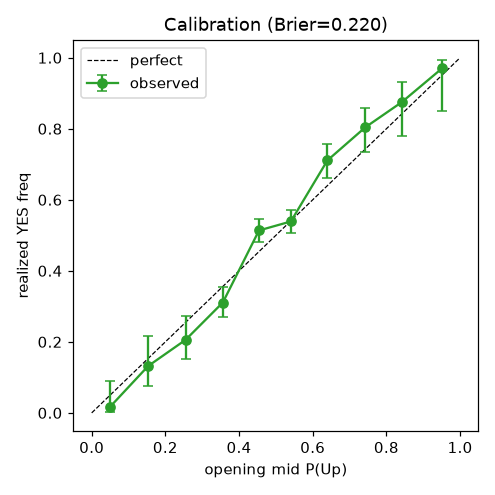
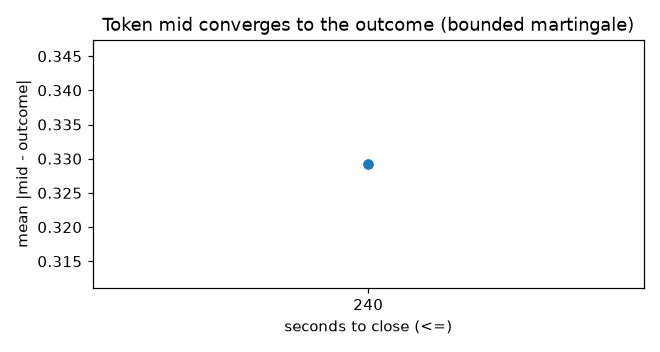
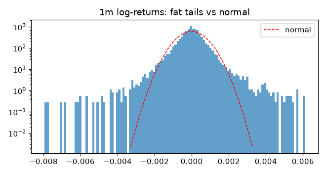
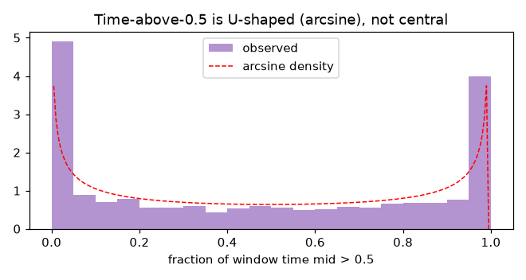

# Market Dynamics — Stochastic-Process EDA (5-min Up/Down)

*Auto-generated by `analyze_dynamics.py`. Design audit: `research/dynamics_design_spec.md`.
3500 windows / 7 assets; underlying = Binance 1m klines aligned to each
window (6 assets; HYPE not on Binance). Token-path stats use a CONSTRUCTED MID
(yes+(1−no))/2 to reduce bid/ask bounce; raw prints are a sensitivity check.*

## 1. The underlying is a near-driftless, fat-tailed random walk
| asset | n | mean | sd | skew | exkurt | VR5 | z5 | z\*5 | SNR | fairUp | LB(r) p | LB(r²) p | ARCH p |
|---|---|---|---|---|---|---|---|---|---|---|---|---|---|
| btc | 5445 | -3.8e-06 | 0.0005 | 0.41 | 9.4 | 1.034 | 1.16 | 0.64 | -0.017 | 0.493 | 0.000 | 0.000 | 0.000 |
| eth | 5435 | -4.6e-06 | 0.0006 | 0.18 | 11.8 | 1.009 | 0.29 | 0.16 | -0.016 | 0.494 | 0.003 | 0.000 | 0.000 |
| sol | 5440 | +1.1e-06 | 0.0008 | 0.06 | 7.3 | 1.043 | 1.45 | 0.91 | 0.003 | 0.501 | 0.042 | 0.000 | 0.000 |
| bnb | 5450 | -6.1e-06 | 0.0005 | -0.80 | 12.9 | 0.979 | -0.71 | -0.40 | -0.027 | 0.489 | 0.040 | 0.000 | 0.000 |
| doge | 4330 | -9.5e-06 | 0.0007 | -0.26 | 12.8 | 0.984 | -0.49 | -0.28 | -0.031 | 0.488 | 0.006 | 0.000 | 0.000 |
| xrp | 4325 | -1.3e-05 | 0.0007 | 0.15 | 8.0 | 0.951 | -1.46 | -0.89 | -0.039 | 0.484 | 0.114 | 0.000 | 0.000 |

- **Drift ≈ 0** (mean 1m return ~1e-5), **fat tails** (excess kurtosis ≫ 0): not Gaussian.
- **Random walk at the 5-min scale**: VR(5) ≈ 1; the heteroskedasticity-robust **z-star**
  (the one to trust under the strong ARCH effect, ARCH p≈0) does not reject a random walk.
- **Vol clustering is real**: Ljung-Box on r² rejects (p≈0) while Ljung-Box on r does not —
  returns are unpredictable in mean but not in variance.

## 2. Why there is no directional edge (the digital-option argument)
An at-the-money 5-min digital has fair YES = Φ(SNR), SNR = μ√n/σ. With μ,σ from the data the
per-asset **SNR ≈ -0.021** ⇒ fair P(Up) within a
couple points of 0.5. Volatility sets the *level* (it pins the price near 0.5); it cannot
create a *directional* edge. Realized vs model:

| asset | model fair P(Up)=Φ(SNR) | realized P(Up) | n |
|---|---|---|---|
| btc | 0.493 | 0.544 | 500 |
| eth | 0.494 | 0.494 | 500 |
| sol | 0.501 | 0.516 | 500 |
| bnb | 0.489 | 0.508 | 500 |
| doge | 0.488 | 0.494 | 500 |
| xrp | 0.484 | 0.492 | 500 |

## 3. The data source is validated (spot direction vs resolution)
| asset | agreement | n |
|---|---|---|
| btc | 0.952 | 499 |
| eth | 0.982 | 495 |
| sol | 0.987 | 479 |
| bnb | 0.980 | 493 |
| doge | 0.992 | 477 |
| xrp | 0.979 | 481 |

Binance 1m direction matches the Polymarket resolution 97.8% pooled — the reference is BTCUSDT-family; residual disagreement is exact-tie / 1m-vs-exact-close timing.

## 4. The binary is well-calibrated — but with a wide effective spread
- **Calibration**: opening mid P(Up) tracks the realized YES frequency along y=x; **Brier =
  0.220** (vs 0.25 for a naive flat-0.5 forecast) — the prices are informative and calibrated.
- **Opening mid ≈ 0.5**: mean deviation -0.0158 (cluster-robust t = -3.83,
  728 wall-clock clusters) — statistically a hair *below* 0.5 (~1.3pp),
  economically negligible and far inside the spread.
- **Wide effective spread / overround**: the contemporaneous (YES+NO) print sum averages
  **1.091** — a ~9% round-trip. This friction alone swamps any thin
  directional edge, and is the microstructure reason every strategy fails net of costs.
- **Vol sets magnitude, not direction**: regressing |opening mid − 0.5| on realized vol gives a
  weak corr 0.107 (higher vol ⇒ the mid sits a little further from 0.5) — but vol does not
  predict the *sign*, exactly as the SNR argument requires.
- **Bounded-martingale convergence**: mean |mid − outcome| falls monotonically to ~0 by close
  (see figure) — the token is a martingale converging to {0,1}.

## 5. "It reverses many times early" — explained, not exploitable
- Constructed-mid increment lag-1 autocorrelation: **0.042** (mid) vs
  **-0.139** (raw prints). The raw negative value is mostly **bid/ask
  bounce** (Roll 1984); on the bounce-reduced mid it shrinks toward 0 (martingale increments).
- 0.5-crossings/window (resampled mid, 10s grid): mean **1.5**
  vs raw prints **4.2** — raw counts are inflated by bounce.
- **Arcsine law**: the fraction of in-window time the mid spends above 0.5 is **U-shaped**
  (most windows spend nearly all their time on the eventual winning side), matching the Lévy
  arcsine law for a martingale — NOT clustering of "early reversals." The frequent early
  crossings are the bounded martingale wandering near 0.5 before committing; there is no
  serial structure to trade.

## Verdict
The 5-min Up/Down market is an **efficiently-priced at-the-money digital option on a
near-driftless, fat-tailed random walk**. It is well-calibrated, its mid is a bounded
martingale converging to the outcome, the underlying is a 5-min random walk, and the
directional signal-to-noise is ≈0.05. **This is the mechanism behind every empirical
null result** (arb, momentum, reversal): there is no directional edge to extract. The
only remaining lever is execution/microstructure — fillability of quote reversals — which
the forward order-book collector is gathering data to test.
