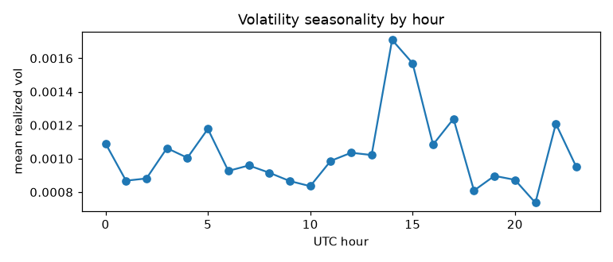
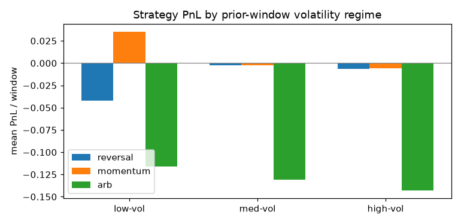

# Regime Analysis — do vol regimes favor any strategy?

*Auto-generated by `analyze_regimes.py`. 2809 consecutive (prev,cur) pairs across the
spot-covered assets. Regime = tercile of the **previous** window's underlying realized vol
(ex-ante: known at the current open). Edges: low ≤ 0.0007 < med ≤ 0.0011 < high.*

## Are regimes predictable?
- **Volatility clusters** ⇒ the regime is forecastable: lag-1 autocorrelation of per-window
  realized vol = **0.428** (n=2808 consecutive pairs). A high-vol
  window is followed by another high-vol window more often than chance, so you can predict the
  next window's regime from the current one.
- There is also intraday **vol seasonality** by UTC hour (see figure).

## Does any strategy do better in a regime?
PnL per window, split by the prior window's vol regime (cluster-robust t, clustered by
wall-clock window). reversal/momentum use realistic ask entry; arb is the passive double-dip
at T=0.49 (generous, ignores the ~9% effective spread).

| strategy | regime | n | mean PnL/win | cluster-robust t |
|---|---|---|---|---|
| reversal | low | 911 | -0.0422 | -2.16 |
| reversal | med | 925 | -0.0022 | -0.12 |
| reversal | high | 923 | -0.0068 | -0.32 |
| momentum | low | 908 | 0.0351 | 1.76 |
| momentum | med | 915 | -0.0027 | -0.14 |
| momentum | high | 918 | -0.0056 | -0.26 |
| arb | low | 937 | -0.1159 | -13.08 |
| arb | med | 936 | -0.1312 | -13.78 |
| arb | high | 936 | -0.1428 | -14.51 |

## Verdict

**Regimes are real and predictable, and the cross-window effect DOES depend on the regime —
but not enough to trade.** Two findings:

1. **Regime dependence (the interesting part).** The serial correlation flips sign with
   volatility. In **low-vol** windows outcomes **persist** (momentum): the reversal bet
   *significantly loses* (-0.0422, t=-2.16)
   while momentum is positive (0.0351, t=1.76).
   In med/high-vol it washes out (means ≈ 0, |t| < 0.5). So the pooled "weak reversion" hides a
   **low-vol momentum / higher-vol noise** structure — exactly the "some regimes favour one
   strategy" hypothesis, qualitatively confirmed.
2. **Still not tradeable.** No (strategy, regime) cell is positive with cluster-robust t > 2.
   The low-vol momentum tilt is **t=1.76 (< 2)** and ≈3.5¢/window —
   smaller than the ~9% effective spread (market_dynamics.md), so it does not survive realistic
   execution. Arb loses in *every* regime (t ≈ −13 to −15).

Because the regime axis is genuinely forecastable (vol autocorr 0.43), this is a fair test of
"trade strategy X only in regime Y": the predictability is there, and there is a real
sign-flip, but the conditional edge is still inside the spread. Next step if pursued: test the
low-vol momentum tilt out-of-sample and against the live order-book spread we collected.
