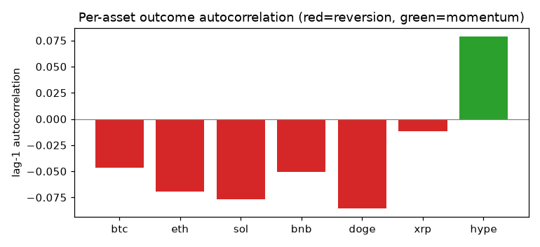
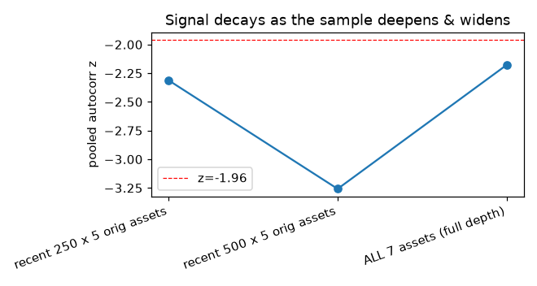
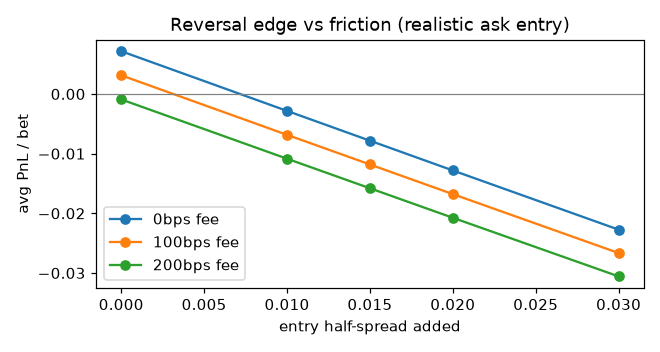

# Reversal Strategy — Analytics (post-audit, full dataset)

*Auto-generated by `analyze_reversal.py`. Methodology audit: `research/reversal_audit.md`.*

## Dataset
3500 resolved windows across 7 assets (btc, eth, sol, bnb, doge, xrp, hype); ~500 per asset.
Truncated windows (tape hit the API offset cap): 28 (0.8%) — excluded from the backtest.

## 1. Is the signal real? (lag-1 autocorrelation of outcomes — uses NO prices)
| asset | n_pairs | autocorr | z | base_up | P(Up\|Up) | P(Up\|Dn) | repeat |
|---|---|---|---|---|---|---|---|
| btc | 493 | -0.047 | -1.04 | 0.505 | 0.482 | 0.529 | 0.477 |
| eth | 494 | -0.069 | -1.54 | 0.514 | 0.480 | 0.549 | 0.466 |
| sol | 496 | -0.077 | -1.71 | 0.506 | 0.468 | 0.544 | 0.462 |
| bnb | 491 | -0.051 | -1.13 | 0.499 | 0.473 | 0.524 | 0.475 |
| doge | 496 | -0.085 | -1.90 | 0.490 | 0.446 | 0.531 | 0.458 |
| xrp | 493 | -0.011 | -0.25 | 0.485 | 0.479 | 0.490 | 0.495 |
| hype | 495 | 0.079 | 1.75 | 0.495 | 0.535 | 0.456 | 0.539 |
| ALL | 3458 | -0.037 | -2.18 | 0.499 | 0.480 | 0.517 | 0.481 |

Negative = mean-reversion (a win tends to follow a loss). The pooled effect is small
and **not uniform**: most assets are weakly negative, **xrp ≈ 0**, and **hype is
positive** (momentum, not reversion). The pooled z below is the *naive* z; it is
inflated because all 7 assets share clock-aligned windows (cross-asset correlation).

## 2. The earlier "significant" result was a small-sample / few-assets artifact
| sample | n_pairs | autocorr | z |
|---|---|---|---|
| recent 250 x 5 orig assets | 1229 | -0.066 | -2.31 |
| recent 500 x 5 orig assets | 2470 | -0.066 | -3.26 |
| ALL 7 assets (full depth) | 3458 | -0.037 | -2.18 |

The first study used the most-recent ~250 windows of 5 highly-correlated majors and
the naive z; deepening to 500/asset and adding 2 less-correlated assets washes the
signal out toward the significance line.

## 3. Is it tradeable? Reversal PnL vs friction (REALISTIC ask entry)
`t_clustered` clusters by wall-clock window (captures cross-asset + serial dependence).
| half_spread | fee_bps | n | win | avg_entry | avg_pnl | t_naive | t_clustered |
|---|---|---|---|---|---|---|---|
| 0.000 | 0 | 3355 | 0.530 | 0.523 | 0.0072 | 0.87 | 0.52 |
| 0.000 | 100 | 3355 | 0.530 | 0.523 | 0.0031 | 0.38 | 0.23 |
| 0.000 | 200 | 3355 | 0.530 | 0.523 | -0.0009 | -0.11 | -0.07 |
| 0.010 | 0 | 3355 | 0.530 | 0.533 | -0.0028 | -0.34 | -0.20 |
| 0.010 | 100 | 3355 | 0.530 | 0.533 | -0.0068 | -0.83 | -0.49 |
| 0.010 | 200 | 3355 | 0.530 | 0.533 | -0.0108 | -1.31 | -0.78 |
| 0.015 | 0 | 3355 | 0.530 | 0.538 | -0.0078 | -0.95 | -0.57 |
| 0.015 | 100 | 3355 | 0.530 | 0.538 | -0.0118 | -1.43 | -0.85 |
| 0.015 | 200 | 3355 | 0.530 | 0.538 | -0.0158 | -1.91 | -1.14 |
| 0.020 | 0 | 3355 | 0.530 | 0.543 | -0.0128 | -1.55 | -0.93 |
| 0.020 | 100 | 3355 | 0.530 | 0.543 | -0.0168 | -2.03 | -1.21 |
| 0.020 | 200 | 3355 | 0.530 | 0.543 | -0.0207 | -2.51 | -1.50 |
| 0.030 | 0 | 3355 | 0.530 | 0.553 | -0.0227 | -2.75 | -1.64 |
| 0.030 | 100 | 3355 | 0.530 | 0.553 | -0.0267 | -3.23 | -1.93 |
| 0.030 | 200 | 3355 | 0.530 | 0.553 | -0.0306 | -3.70 | -2.21 |

**Block bootstrap** (resampling whole wall-clock windows, headline 0-spread/0-fee
scenario): mean PnL/bet 0.0074, 95% CI [-0.0192, 0.0340],
P(mean ≤ 0) = 0.312.

## 4. For contrast: the OLD optimistic entry (buy at earliest print, side-blind)
| half_spread | fee_bps | n | win | avg_entry | avg_pnl | t_naive | t_clustered |
|---|---|---|---|---|---|---|---|
| 0.000 | 0 | 3366 | 0.529 | 0.521 | 0.0076 | 0.92 | 0.55 |
| 0.000 | 100 | 3366 | 0.529 | 0.521 | 0.0036 | 0.43 | 0.26 |
| 0.000 | 200 | 3366 | 0.529 | 0.521 | -0.0005 | -0.06 | -0.03 |
| 0.010 | 0 | 3366 | 0.529 | 0.531 | -0.0024 | -0.29 | -0.17 |
| 0.010 | 100 | 3366 | 0.529 | 0.531 | -0.0064 | -0.78 | -0.46 |
| 0.010 | 200 | 3366 | 0.529 | 0.531 | -0.0104 | -1.26 | -0.75 |
| 0.015 | 0 | 3366 | 0.529 | 0.536 | -0.0074 | -0.90 | -0.53 |
| 0.015 | 100 | 3366 | 0.529 | 0.536 | -0.0114 | -1.38 | -0.82 |
| 0.015 | 200 | 3366 | 0.529 | 0.536 | -0.0154 | -1.86 | -1.11 |
| 0.020 | 0 | 3366 | 0.529 | 0.541 | -0.0124 | -1.50 | -0.90 |
| 0.020 | 100 | 3366 | 0.529 | 0.541 | -0.0164 | -1.98 | -1.18 |
| 0.020 | 200 | 3366 | 0.529 | 0.541 | -0.0203 | -2.46 | -1.47 |
| 0.030 | 0 | 3366 | 0.529 | 0.551 | -0.0223 | -2.70 | -1.61 |
| 0.030 | 100 | 3366 | 0.529 | 0.551 | -0.0262 | -3.18 | -1.89 |
| 0.030 | 200 | 3366 | 0.529 | 0.551 | -0.0301 | -3.65 | -2.18 |

The difference between §3 and §4 is the audit's #1 fix (you cannot buy at a SELL/bid
print). Realistic entry alone removes most of the apparent edge.

## 5. Momentum (opposite bet), realistic entry
| half_spread | fee_bps | n | win | avg_entry | avg_pnl | t_naive | t_clustered |
|---|---|---|---|---|---|---|---|
| 0.000 | 0 | 3351 | 0.491 | 0.513 | -0.0217 | -2.62 | -1.54 |
| 0.000 | 100 | 3351 | 0.491 | 0.513 | -0.0258 | -3.11 | -1.83 |
| 0.000 | 200 | 3351 | 0.491 | 0.513 | -0.0299 | -3.61 | -2.13 |
| 0.010 | 0 | 3351 | 0.491 | 0.523 | -0.0317 | -3.82 | -2.25 |
| 0.010 | 100 | 3351 | 0.491 | 0.523 | -0.0358 | -4.32 | -2.54 |
| 0.010 | 200 | 3351 | 0.491 | 0.523 | -0.0399 | -4.82 | -2.83 |
| 0.015 | 0 | 3351 | 0.491 | 0.528 | -0.0367 | -4.42 | -2.60 |
| 0.015 | 100 | 3351 | 0.491 | 0.528 | -0.0408 | -4.92 | -2.90 |
| 0.015 | 200 | 3351 | 0.491 | 0.528 | -0.0449 | -5.41 | -3.19 |
| 0.020 | 0 | 3351 | 0.491 | 0.533 | -0.0417 | -5.03 | -2.96 |
| 0.020 | 100 | 3351 | 0.491 | 0.533 | -0.0457 | -5.52 | -3.25 |
| 0.020 | 200 | 3351 | 0.491 | 0.533 | -0.0498 | -6.01 | -3.54 |
| 0.030 | 0 | 3351 | 0.491 | 0.543 | -0.0516 | -6.23 | -3.67 |
| 0.030 | 100 | 3351 | 0.491 | 0.543 | -0.0556 | -6.71 | -3.95 |
| 0.030 | 200 | 3351 | 0.491 | 0.543 | -0.0597 | -7.20 | -4.24 |

## Verdict
The negative-autocorrelation *phenomenon* is genuine and look-ahead-free, but it is
**weak, unstable across assets, and not tradeable** after realistic ask entry and
costs: the cluster-robust t-stat does not clear 2 even at zero fee/zero added spread,
and any friction pushes it negative. The earlier +$0.038/bet (t≈2.7) result does not
survive ~3× more data, two additional assets, side-correct entry, and a
dependence-robust standard error.
